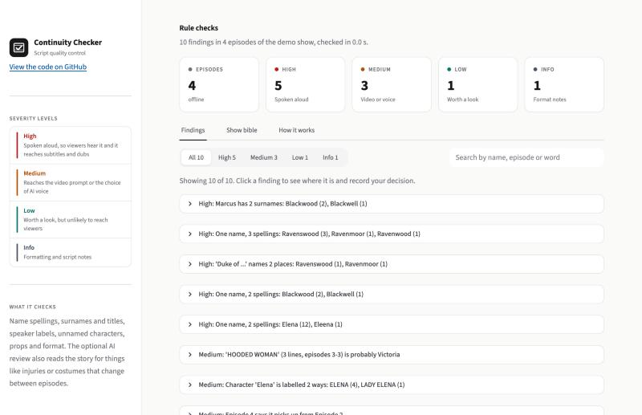
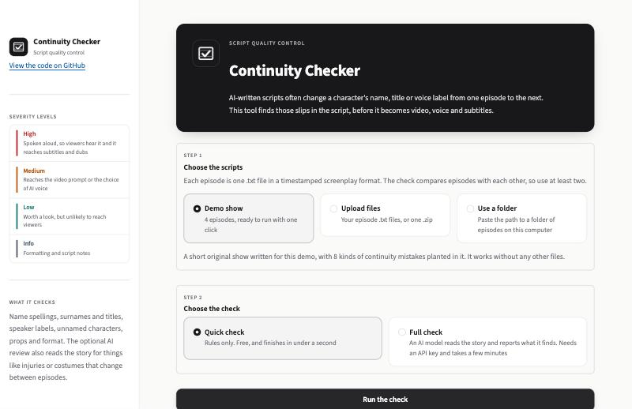
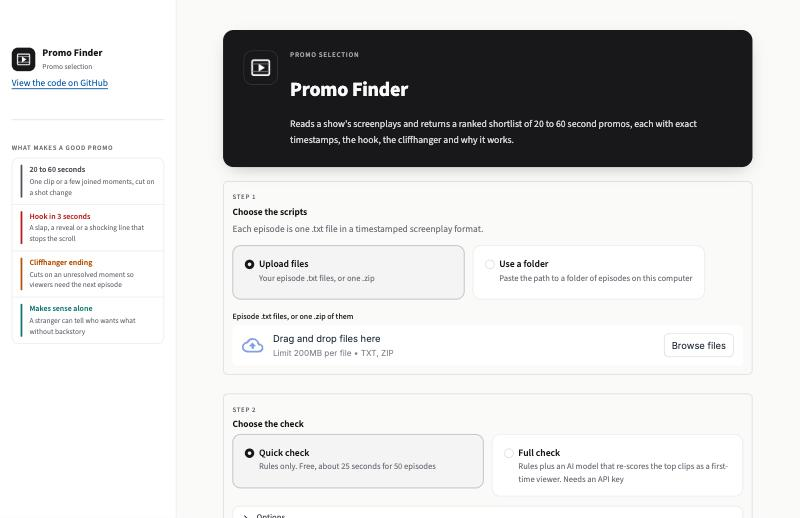
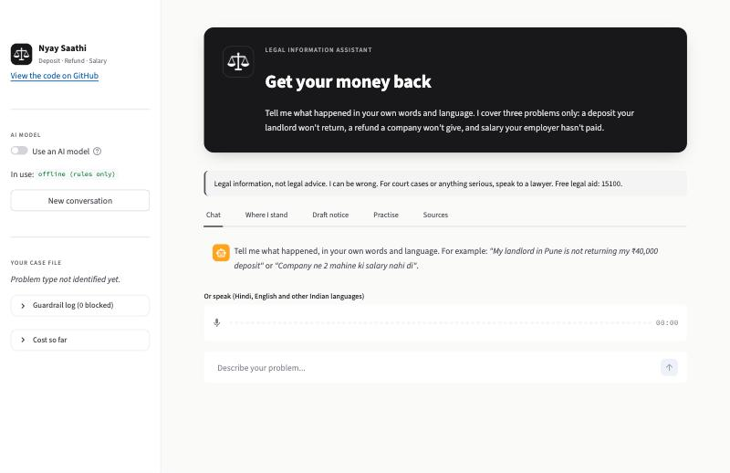

# Microdrama Toolkit

Three tools for the production side of AI-generated microdramas: short vertical series with 1 to 2 minute episodes, released in large numbers. Each one takes a slow, manual step and turns it into something a person can review in minutes.

| Tool | What it does | Folder |
|---|---|---|
| **Continuity Checker** | Finds names, titles, voice labels and props that drift between episodes of a script, before it becomes video, voice and subtitles | `problem3_continuity_checker/` |
| **Promo Finder** | Reads a show's screenplays and returns a ranked shortlist of 20 to 60 second promo clips, with exact timestamps, the hook, the cliffhanger and why each works | `problem1_promo_finder/` |
| **Nyay Saathi** | A chat assistant that helps people in India recover a security deposit, a refund or unpaid salary, and cannot cite a law that has not been verified | `problem2_ai_lawyer/` |



Every tool runs with no API key and no cost. Adding a key from any major AI provider unlocks a deeper review, and the model can be changed with a single setting.

## Contents
- [Quick start](#quick-start)
- [Continuity Checker](#continuity-checker)
- [Promo Finder](#promo-finder)
- [Nyay Saathi](#nyay-saathi)
- [Using an AI model](#using-an-ai-model)
- [How it is built](#how-it-is-built)
- [Command line](#command-line)
- [Repository layout](#repository-layout)
- [Known limitations](#known-limitations)
- [Troubleshooting](#troubleshooting)

## Quick start

Requires Python 3.11 or newer.

```bash
git clone https://github.com/SunnyKK007/KUKU.git
cd KUKU
pip install -r requirements.txt
streamlit run problem3_continuity_checker/app.py
```

The app opens in your browser with a short demo show already loaded, so you can click **Run the check** straight away. The other two tools start the same way:

```bash
streamlit run problem1_promo_finder/app.py
streamlit run problem2_ai_lawyer/app.py
```

## Continuity Checker



### Why it exists

In an AI microdrama pipeline the script feeds everything that follows. A speaker label selects the AI voice, a name in an action line goes into the video prompt, and a name in dialogue becomes a subtitle and then a dub in every language. A wrong name in the script spreads into all of them. Fixing it in the text takes seconds; fixing it after rendering can mean regenerating scenes.

These slips are easy to make and easy to miss. In a 50-episode test show, the hero's surname appears as Ashwin, Ashburn and Ashburton in different episodes, all spoken aloud. His estate is spelled at least nine ways. A villain speaks 53 lines under a generic label while the camera directions use his name, and the lead character is labelled two different ways across 462 lines. Viewers notice: public reviews of microdrama apps complain about wrong character names, faces and pronunciation that shift between scenes, and misspelt subtitles.

### What it checks

| Check | Method | Example finding |
|---|---|---|
| Name spelling drift | Fuzzy matching of proper nouns, ignoring ordinary words that also appear in lower case | 8 spellings of one estate in a single cluster |
| Surname and title drift | Patterns such as "Alexander X" and "Duke of X" | Duke of Ashburn vs Duke of Ashburton |
| Speaker label drift and typos | One label contained in another, or near-identical labels | JULIANA vs LADY JULIANA |
| Unnamed labels | Which name the camera line shows when a generic label speaks, compared with how often that name appears overall | BLOND NOBLEMAN: camera lines name Rupert in 32 of his 53 lines |
| Prop name drift | One owner's object described with different nouns | A mother's book called a ledger, herbarium, journal and grimoire |
| Format checks | Continuity notes pointing at the wrong episode, inconsistent headers | One episode uses a different header format |
| Story-level contradictions | An AI model reads episodes in order with a running list of established facts | Bandages vanish from her injured hands; a wound moves from torso to shoulder |

Each finding carries a severity (**High** when the error is spoken aloud, **Medium** when it reaches video prompts or voice mapping, **Low** and **Info** for the rest), the episode, line number and quoted evidence, and a suggested fix. The app lets a reviewer mark each one **Fix**, **Intended** or **Not an issue**, and download the decisions as a CSV. It also builds a show bible from the scripts: every speaker with line count, episode range and typical delivery, and every location.

### Results

| Measure | Result |
|---|---|
| Rule findings on a 50-episode show | 15, in under a second |
| Confirmed on manual review | 13 clearly real, 1 real but grouped with another, 1 left for a person to decide |
| Planted-error test on 10 unseen rounds | 44 of 45 caught, no false alarms |
| Planted-error test, first version | 17 of 23 caught, which led to two fixes |
| AI review of the same show | 58 findings kept for review, 14 rejected automatically because their quote was not in the script |

The planted-error test copies the scripts, inserts realistic mistakes at random (misspelt names in dialogue, misspelt labels, labels that gain a title, continuity notes pointing to the wrong episode) and measures how many the tool finds. Running it on seeds the tool was never tuned on keeps the score honest.

The AI review finds a different class of error from the rules: physical continuity such as injuries, bandages, chains and costumes, and a character described as someone's mother when he is a cousin. Because model findings vary in accuracy, they are marked **check** rather than **fix**. The reviewer sees AI findings and rule findings separately, depending on which check was run.

### Cost at scale

| Mode | Per show (50 episodes) | At 250 shows a month |
|---|---|---|
| Rules only | $0, under 1 second | $0 |
| With model, Llama 3.3 70B list price | about $0.10 (about 153k input and 12k output tokens) | about $25 |
| With model, a frontier model at $3 and $15 per million tokens | about $0.64 | about $160 |

In production the rules can run on every batch of scripts before video generation, with high-severity findings holding the render until a person signs off. The model review can run on flagged episodes or once per story arc.

## Promo Finder



### Why it exists

Promos are 20 to 60 second clips posted on Instagram, TikTok and YouTube to bring in new viewers. A good one opens on a hook in the first 3 seconds, ends on a cliffhanger, and makes sense to someone who has never seen the show. Finding them means watching every episode. This tool reads the screenplays and hands an editor a ranked shortlist with exact timestamps.

### How it works

| Step | Method | What happens |
|---|---|---|
| Parse | Code | Each episode becomes timed beats with speaker and delivery cue |
| Generate | Code | Every clip of 20 to 60 seconds that starts on a shot change and never cuts a spoken line, about 50,000 for one show |
| Score | Rules | Hook strength in the first 3 seconds, an unresolved ending in the last 4 seconds (with a bonus for the writers' own episode cliffhanger), and standalone clarity |
| Shortlist | Code | The best non-overlapping clips per episode, plus cold-open promos that flash the most shocking 3 to 8 seconds first, a format used widely by short-drama apps |
| Judge | AI model, optional | Re-scores the top 40 clips seeing only the clip, exactly as a stranger scrolling past would |
| Rank | Code | Final score with slate rules that spread picks across the show and across story types, keeping second choices as alternates |
| Review | Person | A one-file review page and a web app where an editor approves or rejects each pick and exports the decisions |

### Results on a 50-episode show

| Measure | Result |
|---|---|
| Promos returned | 25, covering 25 episodes and all 7 story types, in about 25 seconds |
| Cold-open promos | 10 of the 25 |
| Timing checks | 25 of 25 are 20 to 60 seconds, stay inside their episode, cut no dialogue, and open with sound or action |
| Quote accuracy | 676 of 676 quoted script lines match the source at their timestamps |
| Reference moments chosen before tuning | 12 of 16 episodes covered; 9 of 16 exact moments in the slate, 10 with alternates |

Top picks include a wife crawling barehanded into thorns as her husband screams for her to stop, a villain's whispered ultimatum that the husband will hang, and a red-hot iron stopping millimetres from the heroine's eye.

| Mode | Cost per show | At 250 shows a month |
|---|---|---|
| Rules only | $0, about 25 seconds | $0 |
| With model, Llama 3.3 70B | about $0.04 | about $10 |
| With model, a frontier model | about $0.27 | about $70 |

## Nyay Saathi



### Why it exists

Most people in India never get legal help for everyday money disputes, because a lawyer costs more than the amount at stake. Nyay Saathi focuses on three common cases in depth: a security deposit the landlord keeps, a refund a company never pays, and unpaid salary. It turns a messy story into a case file, explains the person's options in plain language, drafts the legal notice, and lets them practise against the other side. Serious matters such as divorce, police cases, property or a court case already running are sent to a lawyer or to free legal aid (NALSA helpline 15100).

### How it works

| Step | Method | What happens |
|---|---|---|
| Intake | Rules, plus a model when available | Understands English, Hindi and Hinglish, extracts amounts, dates, place and proof, and asks for missing facts one at a time |
| Escalation | Code only | Checks every message for threats (and shows the 112 emergency number), police matters, family matters, minors, large amounts and approaching deadlines; a model cannot override it |
| Where you stand | Rules, plus a model to rephrase | Built only from 21 verified law cards: proof strength, step-by-step options and time limits |
| Documents | Templates | A legal notice for each case type, plus a consumer complaint summary for e-Jagriti or a wage claim summary |
| Practise | Script, plus a model when available | Plays the landlord, company or employer using the objections people really hear, and coaches each reply |
| Guardrail | Code only | Checks every outgoing message before the user sees it |

The central design choice is that the model never writes law. Each law card holds a plain-language summary, the exact section, a link to the official source (the Gazette of India, India Code, PIB, NALSA or the National Consumer Helpline) and the date it was checked. The model sees only the relevant cards and must cite them by ID. A validator then scans every message and removes any act or section not on a card, any case citation, any outdated IPC or CrPC reference (replaced by the Bharatiya Nyaya Sanhita in 2024), and any helpline number or website not on the verified list. Every removal is logged and shown in the app. Voice input in Indian languages is available through Sarvam AI when a key is set.

### Results

| Test | Result |
|---|---|
| 15 test conversations, including Hindi, Hinglish, a case-law request, a threatened tenant and a running court case | 14 pass every check |
| Individual checks across all conversations | 106 of 108 |
| Attempts to slip in invented sections, cases, IPC references and helplines | 15 of 15 caught, with real citations kept |
| A deliberately misbehaving fake model that invents law | 10 of 10 safety checks pass |

The test runs also caught and led to fixes for real issues, including a notice that would have demanded the full amount a gym member paid instead of the smaller amount actually owed. In model mode a conversation uses about 12,900 input and 2,600 output tokens, roughly $3.50 to $10.30 per 1,000 conversations depending on the model. Offline mode and all document templates cost nothing.

## Using an AI model

Every tool works in offline mode, which uses rules only, costs nothing and gives the same answer every time. A model adds judgment that rules cannot provide: understanding a story, judging a clip as a first-time viewer would, or answering in the user's own language.

**In the apps:** choose **Full check**, pick a provider and a model from the list, and paste your API key into the key box. The model list is loaded live from the provider, so it shows every model your account can use, with the recommended ones first. The key is kept only for that browser session and is never saved. If the chosen model runs out of its free daily limit, the recommended ones are tried next automatically.

**From the command line, or to avoid pasting a key each time:** create a file named `.env` in the repository folder with one line:

```
GEMINI_API_KEY=your_key_here
```

`.env` is listed in `.gitignore`, so it is never uploaded. `GROQ_API_KEY`, `ANTHROPIC_API_KEY`, `OPENAI_API_KEY` and `OPENROUTER_API_KEY` work the same way. For any other OpenAI-compatible endpoint, set `LLM_BASE_URL`, `LLM_API_KEY` and `LLM_MODEL`. `SARVAM_API_KEY` turns on voice input in Nyay Saathi. Free keys are available from Gemini (aistudio.google.com) and Groq (console.groq.com). Check a key with `python3 check_key.py`.

## How it is built

All three tools follow one principle: code does everything that can be checked mechanically, an AI model does only what needs judgment, and a person makes the final call.

Code parses, counts, matches and validates, because that is free, instant, repeatable and easy to test. A model adds understanding but costs money, can be wrong and can be rate-limited, so its output is always checked by code before anyone sees it. In the Continuity Checker, a model finding is discarded if its quote is not in the script. In Nyay Saathi, the model is never allowed to write law at all. Each tool ends at a review screen where a person approves, rejects or edits the result.

Two shared modules sit underneath all three tools:

- `common/screenplay.py` reads the timestamped screenplay format. Each episode has scenes with start and end times, and each scene holds camera, action, sound and dialogue blocks with their own timestamps. Dialogue also carries a speaker and a delivery cue such as "Cold, Commanding". The parser turns every file into a list of timed beats and handles real-world variation, such as one episode using upper-case scene headers and speakers tagged as off-screen.
- `common/llm.py` is the single connection to AI models. Every supported provider speaks the OpenAI chat format, so changing models is one setting. It caches every response so reruns are free and identical, retries when a service is busy, moves to the next model in a list when one runs out of daily quota, limits each request to 60 seconds so a stuck call never hangs a run, reads JSON even when a model wraps it in extra text, and counts tokens so every run can report its cost.

## Command line

The Continuity Checker and Promo Finder read a folder of episode `.txt` files, one per episode, in the timestamped screenplay format. A four-episode demo show is included in `problem3_continuity_checker/demo_show/`.

```bash
# Continuity Checker
python3 -m problem3_continuity_checker.check_continuity --input problem3_continuity_checker/demo_show --model offline --out outputs/continuity
python3 -m problem3_continuity_checker.inject_test --input "/path/to/episodes" --trials 10 --seed-base 7000

# Promo Finder
python3 -m problem1_promo_finder.find_promos --input "/path/to/episodes" --model offline --out outputs/promos
python3 -m problem1_promo_finder.evaluate --run outputs/promos/promos.json --input "/path/to/episodes"

# Nyay Saathi
python3 -m problem2_ai_lawyer.run_tests --model offline
python3 -m problem2_ai_lawyer.test_validator
python3 -m problem2_ai_lawyer.test_model_stub
```

Choose a model with one flag:

```bash
--model gemini:gemini-3.5-flash
--model "gemini:gemini-3.5-flash,gemini-3.1-flash-lite"   # uses the next model when one runs out of daily quota
--model groq:llama-3.3-70b-versatile
--model anthropic:claude-sonnet-5-5
--model ollama:llama3.1:8b
--model custom:<model-name>      # any OpenAI-compatible endpoint: set LLM_BASE_URL and LLM_API_KEY
```

Without the flag, a tool uses the first key it finds in `.env`, or offline mode if there is none. Running on a new show is the same command with a different `--input` folder.

## Repository layout

```
common/
  screenplay.py            reads the timestamped screenplay format
  llm.py                   one connection to any AI model
  ui.py                    shared look and components for the web apps
  assets/                  app logos
problem3_continuity_checker/
  check_continuity.py      main tool
  checks.py                the rule checks
  llm_check.py             the AI model review
  bible.py                 builds the show bible
  inject_test.py           planted-error test
  demo_show/               a 4-episode demo with planted mistakes
  app.py                   web app
problem1_promo_finder/
  find_promos.py           main tool
  signals.py               hook, cliffhanger and clarity scoring
  judge.py                 the AI model judge
  report.py                JSON, CSV, Markdown and review page
  evaluate.py              quality checks
  app.py                   web app
problem2_ai_lawyer/
  engine.py                conversation engine
  law_cards.json           21 verified law cards
  validator.py             the citation guardrail
  intake.py, escalation.py, advice.py, documents.py, practice.py, casefile.py, voice.py
  run_tests.py, test_validator.py, test_model_stub.py, test_cases.json
  app.py                   web app
outputs/problem2/          full transcripts of the 15 test conversations
assets/screenshots/        images used in this README
check_key.py               checks an API key
```

Outputs from the 50-episode test show quote its scripts, so they are not part of this repository.

## Known limitations

- The Continuity Checker's rules match spellings and patterns, so two completely different descriptions of the same character are left to the AI review, and a deliberate alias is flagged for a person to decide.
- About half of the AI review's findings are real, which is why they are marked "check" rather than "fix".
- The Promo Finder scores shots from their written descriptions and cannot see the generated video, and its word lists are tuned for revenge romance, the most common microdrama genre.
- The Promo Finder's model judge and Nyay Saathi's model mode have been tested end to end with a simulated model but not yet scored with a live one.
- Nyay Saathi gives legal information, not legal advice. Its law cards were checked against official sources in November 2026.

## Troubleshooting

| Problem | Fix |
|---|---|
| `ModuleNotFoundError: common` | Run commands from the repository folder, using `python3 -m ...` as shown. |
| A key is reported missing | Paste it into the key box in the app, add it to `.env`, or run with `--model offline`. |
| A model hits its rate limit | The tool retries, and with a list of models it moves to the next one. Cached answers are reused on a rerun. |
| A model returns malformed JSON | The parser handles extra text and code fences; if a reply still fails, that item is skipped and the run continues. |
| Streamlit says the port is in use | Add `--server.port 8510` to the command. |
